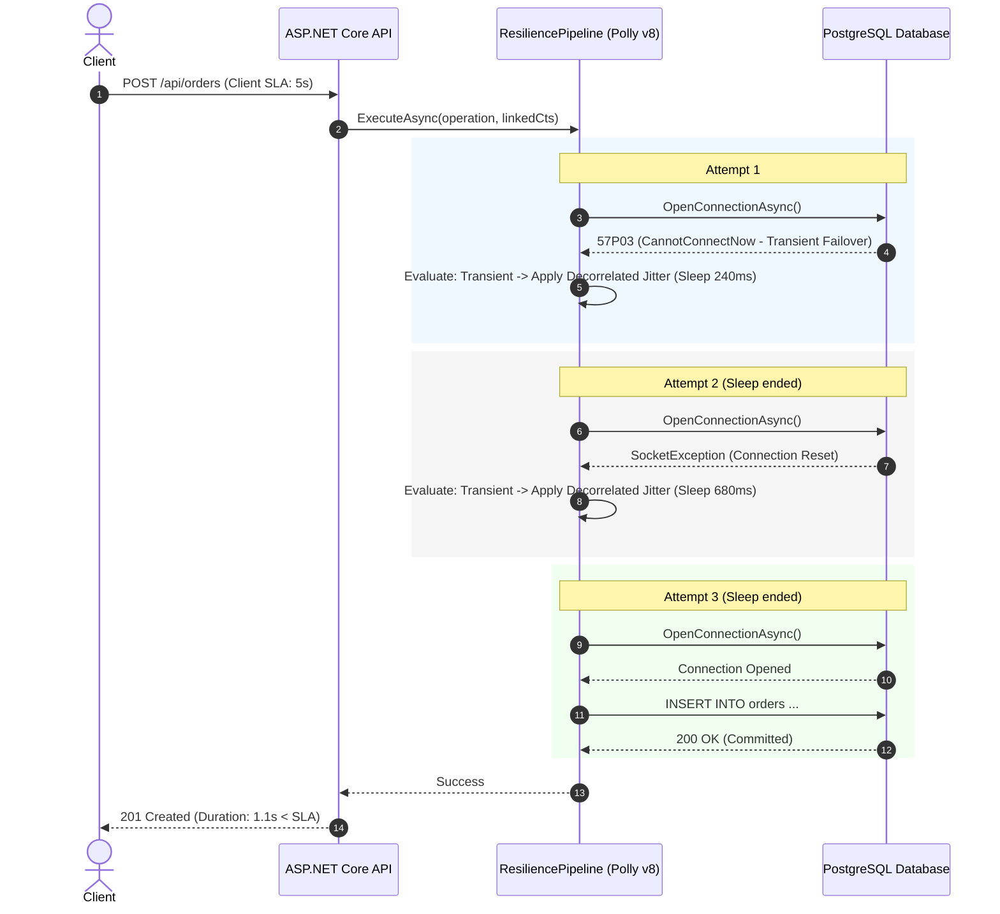

# Connection Resilience in .NET: Principles and Patterns

## Executive Summary

Retry mechanisms—such as Polly pipelines (`Microsoft.Extensions.Resilience`) and Entity Framework Core execution strategies (`IExecutionStrategy`)—are standard safeguards against transient faults (momentary packet drops, database failovers, connection throttling). This guide covers the principles that make them safe: backoff and jitter, retry budgets, timeout and cancellation envelopes, idempotency, and retry layering.

It deliberately stays at the principle level. For the EF Core + Npgsql implementation, see [Guide B](efcore-connection-resilience.md). For diagnostic health checks and orchestrator probes, see [Guide C](health-checks.md).

---

## 1. Architectural Overview & Mental Model

### The Dual-Path Paradigm: Operational vs. Diagnostic

Resilience cannot be treated as a uniform blanket applied identically across all endpoints. Distributed systems must bifurcate traffic into two distinct pathways:

**ASP.NET Core Host**

| Operational Path: `/api/orders` | Diagnostic Path: `/healthz/*` |
|---|---|
| **Goal:** Maximize transaction success | **Goal:** Accurate health reporting |
| **Latency SLA:** 200ms–5000ms | **Probe latency envelope:** <1000ms |
| **Strategy:** Exponential backoff + jitter | **Strategy:** Strictly fail-fast |
| **Resources:** Shared connection pool | **Resources:** Dedicated or direct |
| **Retries:** Allowed (budgeted) | **Retries:** 0 (delegated to Kubernetes) |

| Dimension | Operational Request Pipeline | Diagnostic Health Check Pipeline |
| :--- | :--- | :--- |
| **Primary Objective** | Complete user transactions despite transient blips | Accurately detect process deadlock or downstream reachability |
| **Latency Tolerance** | Elastic (up to HTTP client or ingress timeout, e.g., 5s–30s) | Inelastic (hard orchestrator timeout envelope, e.g., 1000ms) |
| **Retry Strategy** | Decorrelated jitter, retry budgets, circuit breakers | **Zero retries** (Fail-fast; let orchestrator handle retry cadence) |
| **Resource Contention** | Primary connection pool, worker threads | Isolated probe slot, bypass primary queues where possible |
| **Failure Cost** | User-facing HTTP 500 error | Pod termination (`SIGKILL`) or traffic exclusion (unready) |

This guide focuses on the operational path. The diagnostic path—probe taxonomy, orchestrator timeout envelopes, and fail-fast health checks—is covered in [Guide C](health-checks.md).

---

## 2. Advanced Retry Mechanics

### Backoff Mathematics: Exponential Backoff & Jitter

When a downstream dependency encounters contention or transient degradation, immediate retries synchronize requests into massive "thundering herd" spikes. Exponential backoff distributes attempts over time, while **jitter** breaks thread synchronization.

#### 1. Truncated Exponential Backoff

The baseline delay $T_i$ for attempt $i$ (where $i \in \{1, 2, \dots, n\}$) given base delay $B$ and maximum backoff cap $M$:

$$T_i = \min\left(M, B \times 2^{i-1}\right)$$

#### 2. Full Jitter

Full jitter chooses a uniform random distribution between 0 and the calculated exponential ceiling $T_i$:

$$t_{\text{full}} = \text{Uniform}\left(0, \min\left(M, B \times 2^{i-1}\right)\right)$$

*Characteristics*: Maximizes sleep randomness and minimizes peak collision load, but can occasionally schedule retries immediately ($t \approx 0$).

#### 3. Equal Jitter

Equal jitter reserves half the backoff window deterministically and jitters the remaining half:

$$t_{\text{equal}} = \frac{T_i}{2} + \text{Uniform}\left(0, \frac{T_i}{2}\right)$$

*Characteristics*: Prevents immediate retries while preserving jitter distribution.

#### 4. Decorrelated Jitter (Polly v8 / AWS Standard)

Rather than scaling deterministically from attempt index $i$, decorrelated jitter calculates the next sleep duration based on the actual duration of the previous sleep ($t_{i-1}$):

$$t_i = \min\left(M, \text{Uniform}\left(B, t_{i-1} \times 3\right)\right)$$

*Characteristics*: Best-in-class collision avoidance under high concurrency. Recommended default in `Polly.Core` / `Microsoft.Extensions.Resilience`.

---

### Retry Budgets & Storm Amplification

#### The Amplification Factor ($R_{\text{total}}$)

In microservice call trees of depth $D$, unconstrained local retries amplify traffic exponentially. If each hop retries up to $K$ times upon failure:

$$R_{\text{total}} \le \prod_{d=1}^{D} (1 + K_d)$$

For a 3-hop call chain with $K=3$, a single downstream blip can amplify into $(1+3)^3 = 64$ requests hitting the root dependency, converting a 10% packet drop into complete backend saturation.

#### Token Bucket Retry Budgets

To constrain amplification, production systems enforce a **retry budget** (typically 10%–20% of total request volume):
1. Successful calls deposit tokens into a token bucket (e.g., 1 token per success, up to a cap of 100).
2. Each retry attempt consumes tokens (e.g., 5 tokens per retry).
3. If tokens are exhausted, retries are short-circuited immediately and fail-fast without re-attempting.

---

### Cancellation Token Propagation & Timeout Envelopes

A recurring defect in .NET retry implementations is treating timeouts as per-attempt delays while ignoring the **overall operation deadline**.

```
Overall Request Envelope (e.g., 5000ms Deadline)
[========================================================================]
  Attempt 1 (Timeout: 1500ms) -> Failed
  [====]
         Backoff Delay (1000ms)
         [===]
              Attempt 2 (Timeout: 1500ms) -> Failed
              [====]
                     Backoff Delay (2000ms) -> EXCEEDS OVERALL DEADLINE!
                     [===================> CANCELED]
```

#### Linked Token Cancellation Pattern

Every retrying loop must link the caller's cancellation token with both:
1. The **overall invocation deadline** (hard SLA).
2. The **per-attempt timeout** (preventing single socket hangs).

```csharp
public async ValueTask<TResult> ExecuteWithBudgetAsync<TResult>(
    Func<CancellationToken, ValueTask<TResult>> operation,
    TimeSpan overallTimeout,
    TimeSpan perAttemptTimeout,
    CancellationToken externalToken = default)
{
    using var overallCts = CancellationTokenSource.CreateLinkedTokenSource(externalToken);
    overallCts.CancelAfter(overallTimeout);

    var delay = TimeSpan.FromMilliseconds(100);
    var maxDelay = TimeSpan.FromSeconds(2);

    for (var attempt = 1; ; attempt++)
    {
        overallCts.Token.ThrowIfCancellationRequested();

        using var attemptCts = CancellationTokenSource.CreateLinkedTokenSource(overallCts.Token);
        attemptCts.CancelAfter(perAttemptTimeout);

        try
        {
            return await operation(attemptCts.Token);
        }
        catch (OperationCanceledException) when (!overallCts.IsCancellationRequested && attemptCts.IsCancellationRequested)
        {
            // Per-attempt timeout expired; proceed to retry evaluation
        }
        catch (Exception ex) when (IsTransient(ex))
        {
            // Transient error; evaluate retry eligibility
        }

        if (attempt >= 3)
        {
            throw new TimeoutException($"Operation exceeded maximum retry attempts ({attempt}).");
        }

        // Decorrelated jitter backoff calculation
        var jitteredDelay = TimeSpan.FromMilliseconds(Random.Shared.Next((int)delay.TotalMilliseconds, (int)(delay.TotalMilliseconds * 3)));
        delay = jitteredDelay > maxDelay ? maxDelay : jitteredDelay;

        await Task.Delay(delay, overallCts.Token);
    }
}
```

---

## 3. Operational Retry Sequence

### 3.1 Retry Backoff & Jitter in the Operational Path

This sequence demonstrates standard decorrelated jitter backoff handling transient network glitches while honoring the overall cancellation token deadline:



---

## 4. Idempotency and the Lost ACK

Retries are only safe when the operation is idempotent. The most dangerous case is the **lost acknowledgment ("Lost ACK") anomaly**: the connection fails after the database has committed the transaction but before the client receives the confirmation.

### The "Lost ACK" Concurrency Risk

This occurs when the network connection fails *after* PostgreSQL has successfully committed a transaction to disk, but *before* the confirmation packet reaches the client application:

```mermaid
sequenceDiagram
    autonumber
    participant App as EF Core Client
    participant Net as Network / Socket
    participant PG as PostgreSQL Server

    App->>PG: BEGIN; INSERT INTO orders (...); COMMIT;
    Note over PG: PostgreSQL executes operations<br/>and flushes WAL to disk.<br/>Transaction is COMMITTED.
    PG-->>Net: Send CommandComplete ('COMMIT')
    Note over Net: ❌ Network failure drops TCP packet!<br/>Socket is severed.
    Net--xApp: SocketException / Connection reset
    Note over App: Client did NOT receive ACK.<br/>EF Core assumes operation failed.
    Note over App: IExecutionStrategy triggers Retry...
    App->>PG: Reconnect: BEGIN; INSERT INTO orders (...); COMMIT;
    Note over PG: If using DB-generated sequence/identity,<br/>a duplicate order is created!
```

If an entity relies on database-generated primary keys (e.g., `IDENTITY`, `SERIAL`, or database-evaluated `gen_random_uuid()`), retrying the insert will generate a brand new ID and persist a duplicate record.

The concrete EF Core/Npgsql patterns—client-generated UUIDv7 keys, idempotency keys with unique constraints, and `ChangeTracker` hygiene—are covered in [Guide B, §5](efcore-connection-resilience.md#5-idempotency-safeguards--state-management).

---

## 5. Microsoft.Extensions.Resilience (Polly v8) — Operational Pipeline

In modern .NET (.NET 8 through .NET 10), resilience is standardized around the `Microsoft.Extensions.Resilience` package and Polly v8. Unlike earlier Polly versions, Polly v8 is allocation-free and features composable `ResiliencePipeline` instances configured in dependency injection.

### 5.1 Pipeline Decoupling Architecture

Services must register distinct pipelines for user-facing workloads versus diagnostic probes:

```
[ Incoming Request: User Transaction ] 
          │
          ▼
   ┌────────────────────────────────────────────────────────┐
   │ Operational Pipeline ("operational-pipeline")          │
   │  ├─ Overall Timeout (5000ms)                           │
   │  ├─ Decorrelated Jitter Retry (Max: 3, Base: 200ms)    │
   │  ├─ Circuit Breaker (50% failure rate over 10s)        │
   │  └─ Attempt Timeout (1500ms)                           │
   └────────────────────────────────────────────────────────┘

[ Ingress Probe: /healthz/ready ] 
          │
          ▼
   ┌────────────────────────────────────────────────────────┐
   │ Diagnostic Probe Pipeline ("diagnostic-pipeline")      │
   │  ├─ Strict Sub-Second Timeout (800ms)                  │
   │  └─ ZERO RETRIES (Fail-Fast immediately)               │
   └────────────────────────────────────────────────────────┘
```

The diagnostic probe pipeline is intentionally separate. Its registration and use are covered in [Guide C](health-checks.md#7-downstream-http-probes-and-the-diagnostic-pipeline).

### 5.2 Operational Pipeline Registration

```csharp
using Microsoft.Extensions.DependencyInjection;
using Polly;
using Polly.CircuitBreaker;
using Polly.Retry;
using Polly.Timeout;
using System.Net.Sockets;

public static class ResilienceConfigurationExtensions
{
    public static IServiceCollection AddOperationalResiliencePipeline(this IServiceCollection services)
    {
        // =========================================================================
        // Operational Pipeline: Used for transactional calls & downstream APIs
        // =========================================================================
        services.AddResiliencePipeline("operational-pipeline", builder =>
        {
            // Outer overall timeout
            builder.AddTimeout(new TimeoutStrategyOptions
            {
                Timeout = TimeSpan.FromSeconds(5),
                Name = "OperationalOverallTimeout"
            });

            // Decorrelated jitter retry policy
            builder.AddRetry(new RetryStrategyOptions
            {
                MaxRetryAttempts = 3,
                BackoffType = DelayBackoffType.DecorrelatedJitter,
                BaseDelay = TimeSpan.FromMilliseconds(200),
                MaxDelay = TimeSpan.FromSeconds(2),
                ShouldHandle = new PredicateBuilder().Handle<HttpRequestException>()
                                                     .Handle<SocketException>()
                                                     .Handle<TimeoutException>(),
                OnRetry = args =>
                {
                    Console.WriteLine($"[Operational Retry] Attempt {args.AttemptNumber} after {args.RetryDelay.TotalMilliseconds:F0}ms. Cause: {args.Outcome.Exception?.Message}");
                    return ValueTask.CompletedTask;
                }
            });

            // Circuit breaker to protect struggling downstreams
            builder.AddCircuitBreaker(new CircuitBreakerStrategyOptions
            {
                FailureRatio = 0.5,
                SamplingDuration = TimeSpan.FromSeconds(10),
                MinimumThroughput = 8,
                BreakDuration = TimeSpan.FromSeconds(15),
                ShouldHandle = new PredicateBuilder().Handle<HttpRequestException>()
                                                     .Handle<SocketException>()
            });

            // Per-attempt timeout
            builder.AddTimeout(new TimeoutStrategyOptions
            {
                Timeout = TimeSpan.FromMilliseconds(1500),
                Name = "OperationalPerAttemptTimeout"
            });
        });

        return services;
    }
}
```

The diagnostic pipeline is registered separately; see [Guide C](health-checks.md#7-downstream-http-probes-and-the-diagnostic-pipeline).

---

## 6. Observability Principles

Transparent observability ensures engineers can see retry pressure, circuit state, and long-tail latency in operational pipelines.

### 6.1 Retry and Circuit Metrics

```csharp
// Program.cs
builder.Services.AddOpenTelemetry()
    .WithMetrics(metrics =>
    {
        metrics
            .AddMeter("Microsoft.Extensions.Resilience") // Polly v8 metrics
            .AddPrometheusExporter();
    })
    .WithTracing(tracing =>
    {
        tracing
            .AddSource("Microsoft.Extensions.Resilience")
            .AddAspNetCoreInstrumentation();
    });
```

#### Key Metrics to Alert On

| Metric Name | Instrument | Description | Healthy Threshold |
| :--- | :--- | :--- | :--- |
| `resilience.polly.strategy.execution.attempt.count` | Counter | Total retry attempts triggered | $< 2\%$ of total requests |
| `resilience.polly.circuitbreaker.state` | UpDownCounter | Circuit state (0: Closed, 1: Open, 2: Half-Open) | 0 (Closed) |

Database pool and EF Core metrics are covered in [Guide B](efcore-connection-resilience.md). Probe duration and status metrics are covered in [Guide C](health-checks.md#8-observability-probe-metrics-tagging-and-logging).

### 6.2 Structured Logging for Retries

When a retry occurs, structured logging must provide actionable contextual dimensions without flooding log collectors.

```json
{
  "Timestamp": "2026-11-06T23:14:02.102Z",
  "LogLevel": "Warning",
  "Message": "Operational request retry attempt scheduled.",
  "Pipeline": "operational-pipeline",
  "Strategy": "Retry",
  "AttemptNumber": 2,
  "RetryDelayMs": 348,
  "ExceptionType": "Npgsql.NpgsqlException",
  "SqlState": "57P03",
  "TraceId": "4bf92f3577b34da6a3ce929d0e0e4736"
}
```

---

## 7. Summary Checklist

| Category | Recommended Practice | Dangerous Anti-Pattern |
| :--- | :--- | :--- |
| **Retry Backoff** | Use **Decorrelated Jitter** for operational pipelines to prevent thundering herd spikes. | Fixed delays or naive linear retries without randomized jitter. |
| **Retry Budgets** | Enforce retry token budgets (max 10%–20% retries) across distributed call chains. | Unbounded retries creating exponential amplification storms ($R = \prod (1+K)$). |
| **Deadlines** | Always link per-attempt timeouts to an overall operation deadline `CancellationToken`. | Per-attempt timeouts without an overall deadline, allowing operations to hang indefinitely. |

---

## 8. Related Guides

- [**Guide B — Entity Framework Core Connection Resilience on PostgreSQL**](efcore-connection-resilience.md): execution strategy mechanics, SQLSTATE taxonomy, retriable units, idempotency patterns, observability, and chaos testing for EF Core + Npgsql.
- [**Guide C — Health Checks in .NET**](health-checks.md): probe taxonomy, orchestrator timeout envelopes, failure modes, fail-fast health checks, and EF Core/Npgsql health-check isolation.
- [**Suite index**](README.md): choose the right guide for the task.
