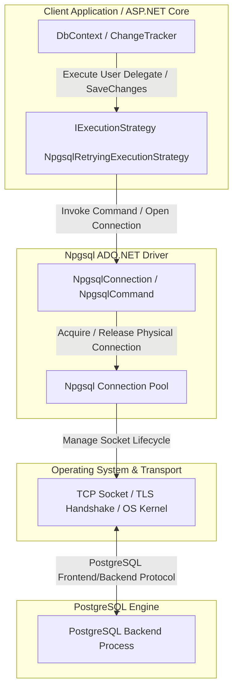

# Entity Framework Core Connection Resilience on PostgreSQL (.NET 10)

## Executive Summary

In distributed, cloud-native architectures, transient infrastructure faults—such as transient network blips, container restarts, Kubernetes pod rescheduling, Azure/AWS managed database maintenance failovers, and connection pool exhaustion—are inevitable. When building services with **.NET 10**, **Entity Framework Core (EF Core)**, and **PostgreSQL** via `Npgsql.EntityFrameworkCore.PostgreSQL`, handling these transient faults gracefully is crucial for maintaining high availability and system reliability.

This guide provides an authoritative reference and engineering standard for implementing connection resilience. It details the internal mechanics of EF Core's `IExecutionStrategy`, driver-level pooling in Npgsql, configuration standards, transaction management patterns, idempotency safeguards against the "lost ACK" anomaly, custom retry strategies, OpenTelemetry observability, and chaos testing techniques.

---

## Table of Contents

1. [Architectural Overview & Mental Model](#1-architectural-overview--mental-model)
   - [Layered Architecture: Sockets, Npgsql Driver, and EF Core](#layered-architecture-sockets-npgsql-driver-and-ef-core)
   - [Execution Strategy Mechanics (Backoff, Exponential Jitter)](#execution-strategy-mechanics-backoff-exponential-jitter)
2. [Configuration Standards in .NET 10](#2-configuration-standards-in-net-10)
   - [Configuring `EnableRetryOnFailure` in `Program.cs`](#configuring-enableretryonfailure-in-programcs)
   - [Configuration Options & Parameters](#configuration-options--parameters)
3. [PostgreSQL Transient Failure Taxonomy](#3-postgresql-transient-failure-taxonomy)
   - [Transient SQLState Error Codes](#transient-sqlstate-error-codes)
   - [Non-Transient Failures: Deadlocks & Serialization Conflicts](#non-transient-failures-deadlocks--serialization-conflicts)
   - [Summary Comparison Matrix](#summary-comparison-matrix)
4. [Explicit Transactions & The Retriable Unit Pattern](#4-explicit-transactions--the-retriable-unit-pattern)
   - [Why `BeginTransaction()` Fails Under Retry Strategies](#why-begintransaction-fails-under-retry-strategies)
   - [The Retriable Unit Pattern: `strategy.ExecuteAsync`](#the-retriable-unit-pattern-strategyexecuteasync)
5. [Idempotency Safeguards & State Management](#5-idempotency-safeguards--state-management)
   - [The "Lost ACK" Concurrency Risk](#the-lost-ack-concurrency-risk)
   - [EF Core `ChangeTracker` Behavior Across Retries](#ef-core-changetracker-behavior-across-retries)
   - [Mitigation Patterns & UUIDv7 Keys](#mitigation-patterns--uuidv7-keys)
6. [Extending Execution Strategies](#6-extending-execution-strategies)
   - [Subclassing `NpgsqlRetryingExecutionStrategy`](#subclassing-npgsqlretryingexecutionstrategy)
   - [Registering Custom Execution Strategies](#registering-custom-execution-strategies)
7. [Observability & Telemetry in .NET 10](#7-observability--telemetry-in-net-10)
   - [EF Core Diagnostic Logging for Retries](#ef-core-diagnostic-logging-for-retries)
   - [OpenTelemetry Traces & Metrics Integration](#opentelemetry-traces--metrics-integration)
8. [Chaos Testing & Resilience Verification](#8-chaos-testing--resilience-verification)
   - [Testing Strategy with EF Core Interceptors](#testing-strategy-with-ef-core-interceptors)
   - [Fault-Injection Interceptor Implementation](#fault-injection-interceptor-implementation)
9. [Summary Checklist & Best Practices](#9-summary-checklist--best-practices)
10. [Related Guides](#10-related-guides)

## 1. Architectural Overview & Mental Model

### Layered Architecture: Sockets, Npgsql Driver, and EF Core

Understanding resilience requires drawing clear boundaries between the three architectural layers involved in communicating with PostgreSQL:



#### Layer Responsibilities

1. **Operating System & Network (TCP Sockets)**
   - Manages physical packets, TCP keep-alives, connection handshakes, and transport interruptions (e.g. RST packets, NAT timeouts).
   - Reports raw network failures as OS-level socket errors (e.g., `SocketException`, `ECONNRESET`, `ETIMEDOUT`).

2. **ADO.NET Provider (`Npgsql`)**
   - **Connection Pooling**: Maintains a pool of open, idle physical connections to PostgreSQL. When your application calls `connection.OpenAsync()`, Npgsql checks out an existing connection from the pool rather than establishing a fresh TCP/TLS handshake.
   - **Protocol Serialization**: Translates .NET queries and parameters into the PostgreSQL Frontend/Backend protocol.
   - **Physical Connection Health**: When a network fault breaks a physical connection, Npgsql marks that connection as broken and purges it from the pool.
   - **Crucial Distinction**: The driver does *not* automatically retry failed SQL commands or transactions on a new connection. Doing so blindly could duplicate non-idempotent operations or violate transaction state.

3. **ORM Layer (EF Core `IExecutionStrategy`)**
   - **Operation Wrapper**: Wraps high-level operations (`SaveChanges`, LINQ queries, or explicit code blocks) in a retry loop.
   - **Failure Classification**: Catches exceptions thrown during database interaction. Evaluates whether the exception represents a transient fault (via `ShouldRetryOn(Exception)`).
   - **Clean Re-execution**: On transient failure, discards broken state, waits for an exponentially calculated delay with randomized jitter, requests a fresh connection from Npgsql's pool, and re-executes the user's operation delegate from the beginning.

---

### Execution Strategy Mechanics (Backoff, Exponential Jitter)

When a transient error occurs, immediate retry often exacerbates server overload, leading to catastrophic "thundering herd" spikes. EF Core's retrying execution strategy employs **exponential backoff with randomized jitter**. The underlying mathematics—truncated exponential backoff, full jitter, equal jitter, and decorrelated jitter—are covered in [Guide A, §2](connection-resilience.md#2-advanced-retry-mechanics).

Within that pattern, EF Core's strategy uses these parameters:

- $i$ is the zero-indexed retry attempt ($0, 1, 2, \dots, N$).
- $D_{\text{base}}$ is the base backoff interval (default: ~1 second).
- $D_{\text{max}}$ is the maximum allowable retry delay (default: 30 seconds).

With the defaults, the schedule looks like this:

```
Attempt 1: ~1.0s (± jitter)
Attempt 2: ~2.0s (± jitter)
Attempt 3: ~4.0s (± jitter)
Attempt 4: ~8.0s (± jitter)
Attempt 5: ~16.0s (capped at MaxRetryDelay)
```

## 2. Configuration Standards in .NET 10

### Configuring `EnableRetryOnFailure` in `Program.cs`

In modern .NET 10 applications, database contexts are typically registered in `Program.cs` using `AddDbContext<TContext>` or `AddDbContextPool<TContext>`. Connection resilience is enabled on the `NpgsqlDbContextOptionsBuilder` via `EnableRetryOnFailure`.

```csharp
// Program.cs (.NET 10)
using Microsoft.EntityFrameworkCore;
using Npgsql.EntityFrameworkCore.PostgreSQL;

var builder = WebApplication.CreateBuilder(args);

// Read configuration from appsettings.json or environment variables
var connectionString = builder.Configuration.GetConnectionString("DefaultConnection")
    ?? throw new InvalidOperationException("Connection string 'DefaultConnection' was not found.");

builder.Services.AddDbContextPool<AppDbContext>(options =>
{
    options.UseNpgsql(connectionString, npgsqlOptions =>
    {
        // Enable built-in Npgsql retrying execution strategy
        npgsqlOptions.EnableRetryOnFailure(
            maxRetryCount: 5,
            maxRetryDelay: TimeSpan.FromSeconds(30),
            errorCodesToAdd: null // Optional: Add extra PostgreSQL SQLState codes if required
        );

        // Standard performance and migration tuning
        npgsqlOptions.CommandTimeout(60); // In seconds
        npgsqlOptions.MigrationsHistoryTable("__EFMigrationsHistory", "public");
    });

    // Optional: Log detailed entity framework execution events during development
    if (builder.Environment.IsDevelopment())
    {
        options.EnableDetailedErrors();
        options.EnableSensitiveDataLogging();
    }
});

var app = builder.Build();

app.MapGet("/", () => "Service is healthy");

app.Run();
```

---

### Configuration Options & Parameters

When configuring `EnableRetryOnFailure`, consider the following parameters and best practices:

| Parameter | Type | Default | Guidance & Best Practice |
| :--- | :--- | :--- | :--- |
| `maxRetryCount` | `int` | `6` | Maximum number of sequential retry attempts for a failed operation. For user-facing Web API endpoints, setting this to `3` to `5` prevents request execution timeouts from HTTP clients (e.g. 15-30s gateway limits). For background workers, `5` to `10` is typical. |
| `maxRetryDelay` | `TimeSpan` | `30 seconds` | The upper limit ceiling for exponential backoff delays. Regardless of how high the calculated backoff grows, sleep intervals will not exceed this duration. |
| `errorCodesToAdd` | `ICollection<string>?` | `null` | Additional PostgreSQL SQLState codes that should be treated as transient. Pass custom application-specific transient error codes here if PostgreSQL extensions or custom stored procedures return transient error conditions. |

#### Complementary Connection String Parameters

In addition to EF Core's `EnableRetryOnFailure`, ensure Npgsql connection string parameters are properly calibrated:

- `Timeout` (Default: 15s): The socket connection establishment timeout. If establishing a physical socket to the database server takes longer than this value, Npgsql aborts and EF Core retries if attempts remain.
- `Command Timeout` (Default: 30s): The query execution timeout. If a query hangs due to a server lock or network partition, Npgsql cancels the command.
- `Keepalive` (Default: 0 / Disabled): Recommended set to `30` or `15` seconds in cloud environments (e.g., AWS RDS, Azure Database for PostgreSQL) to prevent intermediary stateful NAT gateways, firewalls, and load balancers from silently dropping idle TCP connections.

```json
{
  "ConnectionStrings": {
    "DefaultConnection": "Host=db.internal;Port=5432;Database=orders;Username=app_user;Password=secret;Timeout=15;Command Timeout=30;Keepalive=30;Pooling=true;Minimum Pool Size=10;Maximum Pool Size=100;"
  }
}
```

> [!WARNING]
> **The retrying strategy also applies to health checks.** `AddDbContextCheck<AppDbContext>()` invokes `DbContext.Database.CanConnectAsync()`, which runs inside `NpgsqlRetryingExecutionStrategy`. A readiness probe can therefore spend its entire orchestrator timeout retrying instead of reporting failure. Register health checks against a non-retrying path with its own short timeout. See [Guide C, §6](health-checks.md#6-database-health-check-isolation-patterns).

## 3. PostgreSQL Transient Failure Taxonomy

PostgreSQL categorizes errors using 5-character alphanumeric **SQLState** codes (conforming to the SQL:1999 standard). Understanding which codes represent transient infrastructure failures versus concurrency or application logic errors is vital when designing resilient systems.

---

### Transient SQLState Error Codes

Transient failures occur when the underlying network connection or database backend process becomes temporarily unreachable, but is expected to recover quickly. `NpgsqlRetryingExecutionStrategy` classifies the following conditions as transient:

#### 1. Server Lifecycle & Shutdown (`Class 57 — Operator Intervention`)
- **`57P01` (`admin_shutdown`)**: The PostgreSQL server process is shutting down due to administrative intervention (e.g., automated patching, managed cloud failover in AWS RDS / Azure Flexible Server). Retrying allows the application to reconnect to the newly promoted primary replica.
- **`57P02` (`crash_shutdown`)**: The backend process terminated unexpectedly and the database is performing crash recovery.
- **`57P03` (`cannot_connect_now`)**: The database engine is currently in recovery or startup mode and not yet accepting client traffic.

#### 2. Resource Constraints (`Class 53 — Insufficient Resources`)
- **`53300` (`too_many_connections`)**: The database has exceeded `max_connections` or PgBouncer client pool limits. Backing off with randomized jitter allows active transactions to complete, freeing slots for retry attempts.

#### 3. Connection Exceptions (`Class 08 — Connection Exception`)
- **`08000` (`connection_exception`)**: Generic connection breakdown.
- **`08001` (`sqlclient_unable_to_establish_sqlconnection`)**: Client cannot establish a TCP connection to the specified host/port.
- **`08003` (`connection_does_not_exist`)**: Attempted operation on a closed or severed connection.
- **`08004` (`sqlserver_rejected_establishment_of_sqlconnection`)**: Database rejected connection attempt during handshake.
- **`08006` (`connection_failure`)**: Physical connection dropped unexpectedly while executing a command.
- **`08007` (`transaction_resolution_unknown`)**: Connection dropped during transaction commit; status of the commit is unknown to the client (see [Section 5: The Lost ACK Problem](#5-idempotency-safeguards--state-management)).

#### 4. Socket & Transport-Level Exceptions
- In addition to PostgreSQL SQLStates, raw socket and I/O exceptions caught by Npgsql are treated as transient:
  - `System.Net.Sockets.SocketException` (e.g. `SocketError.ConnectionReset`, `SocketError.TimedOut`, `SocketError.NetworkUnreachable`).
  - `System.IO.IOException` wrapping socket aborts.
  - `Npgsql.NpgsqlException` containing nested transport errors or query cancellations due to pool exhaustion.

---

### Non-Transient Failures: Deadlocks & Serialization Conflicts

A common misconception is that all PostgreSQL errors that can succeed upon retry should be handled by `IExecutionStrategy`. Concurrency conflicts—specifically deadlocks and serialization failures—are **not** classified as connection transients.

#### Concurrency Codes
- **`40P01` (`deadlock_detected`)**: Two or more concurrent transactions hold conflicting row or table locks and are blocked waiting for each other. PostgreSQL's deadlock detector cancels one transaction.
- **`40001` (`serialization_failure`)**: Occurs under `SERIALIZABLE` or `REPEATABLE READ` transaction isolation levels when concurrent transactions produce an execution order that violates serializability (Serializable Snapshot Isolation anomaly).

#### Why Concurrency Conflicts are Not Transient Connection Failures

| Dimension | Connection / Infrastructure Failures | Concurrency Failures (`40P01`, `40001`) |
| :--- | :--- | :--- |
| **Origin** | Hardware, network, pod restart, managed database failover | Application-level contention between concurrent transactions |
| **Socket Health** | Connection is severed or corrupted | Connection remains completely healthy and intact |
| **Remediation Target** | Re-establish TCP socket, fetch healthy connection from pool | Abort transaction, evaluate conflict, rollback business state, re-run with fresh snapshots |
| **Danger of Blind Retry** | Low, provided idempotency is protected | **High**: Blind retries under high contention without application-level backoff can induce persistent livelocks |

> [!IMPORTANT]
> EF Core's `EnableRetryOnFailure` does not catch or retry `40P01` or `40001` by default. If your workload requires serializable transactions or experiences deadlocks under peak loads, handle `DbUpdateConcurrencyException` or catch `PostgresException` with `SqlState == PostgresErrorCodes.SerializationFailure` at the application/service boundary or via a custom execution strategy (see [Section 6](#6-extending-execution-strategies)).

---

### Summary Comparison Matrix

| Error Code / Exception | Description | Classification | Default Action in `NpgsqlRetryingExecutionStrategy` |
| :--- | :--- | :--- | :--- |
| `57P01` | `admin_shutdown` | Transient | **Retry** with exponential backoff & jitter |
| `57P02` | `crash_shutdown` | Transient | **Retry** with exponential backoff & jitter |
| `57P03` | `cannot_connect_now` | Transient | **Retry** with exponential backoff & jitter |
| `53300` | `too_many_connections` | Transient | **Retry** with exponential backoff & jitter |
| `08000` - `08007` | Connection exceptions | Transient | **Retry** with exponential backoff & jitter |
| `SocketException` | Socket abort / reset / timeout | Transient | **Retry** with exponential backoff & jitter |
| `40P01` | `deadlock_detected` | Concurrency Conflict | **Fail immediately** (Exception propagates to caller) |
| `40001` | `serialization_failure` | Concurrency Conflict | **Fail immediately** (Exception propagates to caller) |
| `23505` | `unique_violation` | Data Integrity Violation | **Fail immediately** (Terminal error) |
| `23503` | `foreign_key_violation` | Data Integrity Violation | **Fail immediately** (Terminal error) |
| `42P01` | `undefined_table` | Schema / Syntax Error | **Fail immediately** (Terminal error) |

## 4. Explicit Transactions & The Retriable Unit Pattern

### Why `BeginTransaction()` Fails Under Retry Strategies

A frequent source of developer confusion occurs when attempting to create manual, user-initiated transactions after enabling connection resilience:

```csharp
// ❌ THIS THROWS InvalidOperationException!
await using var transaction = await context.Database.BeginTransactionAsync();

order.Status = OrderStatus.Processing;
await context.SaveChangesAsync();

await paymentGateway.ChargeAsync(order.Id);

await transaction.CommitAsync();
```

When `EnableRetryOnFailure` is active, executing the code above will immediately throw:

```text
System.InvalidOperationException: The configured execution strategy 'NpgsqlRetryingExecutionStrategy'
does not support user-initiated transactions. Use the execution strategy returned by
'DbContext.Database.CreateExecutionStrategy()' to execute all the operations in the transaction
as a retriable unit.
```

#### Why Does EF Core Block User-Initiated Transactions?

Consider what happens if step 2 succeeds on PostgreSQL, but step 3 encounters a transient socket drop:
1. If the execution strategy only retried step 3, it would acquire a **new** connection from the pool.
2. The transaction started in step 1 exists exclusively on the **original** (now dead) physical connection. On PostgreSQL, any uncommitted transaction on a severed socket is automatically rolled back by the backend process.
3. Executing step 3 on a new connection without step 1 and step 2 would run in autocommit mode or corrupt data consistency.

To guarantee ACID guarantees, EF Core enforces that **the entire transaction boundary must be re-run as a unified, retriable unit**.

---

### The Retriable Unit Pattern: `strategy.ExecuteAsync`

To use explicit transactions alongside connection resilience, obtain an `IExecutionStrategy` instance from the `DbContext` and enclose the transaction lifecycle (`BeginTransactionAsync`, data operations, and `CommitAsync`) inside the strategy delegate.

```csharp
using Microsoft.EntityFrameworkCore;

public class OrderProcessingService(AppDbContext context, ILogger<OrderProcessingService> logger)
{
    public async Task ProcessOrderBatchAsync(Guid batchId, List<OrderUpdateDto> updates, CancellationToken ct)
    {
        // 1. Create the execution strategy from the current DbContext instance
        var strategy = context.Database.CreateExecutionStrategy();

        // 2. Execute the entire transactional block inside the strategy delegate
        await strategy.ExecuteAsync(async () =>
        {
            // 3. Begin the explicit database transaction INSIDE the delegate
            await using var transaction = await context.Database.BeginTransactionAsync(ct);

            logger.LogInformation("Starting transactional batch update for BatchId: {BatchId}", batchId);

            foreach (var update in updates)
            {
                var order = await context.Orders.FindAsync([update.OrderId], ct);
                if (order is null)
                {
                    throw new InvalidOperationException($"Order {update.OrderId} not found.");
                }

                order.UpdateStatus(update.NewStatus);
                order.Notes = update.Notes;
            }

            // 4. Save changes
            await context.SaveChangesAsync(ct);

            // 5. Commit the transaction inside the delegate
            await transaction.CommitAsync(ct);

            logger.LogInformation("Successfully committed batch update for BatchId: {BatchId}", batchId);
        });
    }
}
```

#### Critical Rules for Retriable Units

1. **Transaction Lifecycle Inside the Lambda**: `BeginTransactionAsync` and `transaction.CommitAsync` must be instantiated *inside* the `ExecuteAsync` delegate.
2. **Local State Reset**: Any in-memory variables modified within the delegate will run multiple times if retries occur. Ensure local state is recalculated or reset at the start of each iteration.
3. **No External Side Effects**: Never trigger external non-rollbackable actions (such as sending emails or charging payment cards) inside the delegate unless protected by an outbox pattern or distributed two-phase commit. External API calls cannot be rolled back when PostgreSQL aborts a transaction.

## 5. Idempotency Safeguards & State Management

### The "Lost ACK" Concurrency Risk

The most perilous edge-case in database connection resilience is the **Lost Acknowledgment ("Lost ACK") anomaly**: the network connection fails *after* PostgreSQL has committed a transaction but *before* the confirmation packet reaches the client. The client assumes failure and retries an operation that already succeeded. The general mechanism and its consequences are covered in [Guide A, §4](connection-resilience.md#4-idempotency-and-the-lost-ack).

For EF Core, the concrete consequence is that a retried insert against an entity with a database-generated primary key (e.g., `IDENTITY`, `SERIAL`, or database-evaluated `gen_random_uuid()`) generates a brand new ID and persists a duplicate record. The patterns below make that retry safe.

---

### EF Core `ChangeTracker` Behavior Across Retries

When `strategy.ExecuteAsync(...)` retries a delegate, the `DbContext` instance may retain tracked entities from the previous failed attempt.

#### State Contamination Pitfalls
1. **Entity State Flips**: In EF Core, calling `context.SaveChangesAsync()` ordinarily marks added entities as `EntityState.Unchanged` upon successful completion. However, if the network drops midway through `SaveChangesAsync()`, some entities may remain `EntityState.Added` while others are marked `Unchanged`, leaving the `ChangeTracker` in an indeterminate, corrupted state.
2. **Duplicate Tracking Collisions**: If your retry delegate attempts to query or attach fresh entities while the `DbContext` still holds references with identical primary keys, EF Core throws:
   `InvalidOperationException: The instance of entity type 'Order' cannot be tracked because another instance with the same key value is already being tracked.`

#### Safeguarding ChangeTracker State
To prevent tracker contamination, use one of two architectural approaches:
- **Approach A (Recommended for Retriable Units)**: Reset tracking via `context.ChangeTracker.Clear()` at the beginning of the delegate.
- **Approach B**: Scope the creation of a new `DbContext` instance per retry attempt using `IDbContextFactory<TContext>`.

---

### Mitigation Patterns & UUIDv7 Keys

#### Pattern 1: Client-Generated UUIDv7 Primary Keys

Modern .NET 10 provides native support for RFC 9562 Version 7 UUIDs via `Guid.CreateVersion7()`. Unlike random UUIDv4, UUIDv7 incorporates a millisecond timestamp prefix, making it sequential and index-friendly (preventing B-tree page fragmentation in PostgreSQL) while allowing the client to establish the primary key *before* transmitting SQL.

```csharp
using System.ComponentModel.DataAnnotations;
using Microsoft.EntityFrameworkCore;

public class Order
{
    // Client assigns deterministic ID before sending to EF Core
    public Guid Id { get; init; } = Guid.CreateVersion7();

    public string CustomerEmail { get; set; } = string.Empty;
    public decimal TotalAmount { get; set; }
    public DateTimeOffset CreatedAt { get; init; } = DateTimeOffset.UtcNow;
}
```

```csharp
public async Task<Order> CreateOrderAsync(CreateOrderDto dto, CancellationToken ct)
{
    var strategy = context.Database.CreateExecutionStrategy();

    // Generate the deterministic entity and key OUTSIDE or at the start
    var orderId = Guid.CreateVersion7();

    return await strategy.ExecuteAsync(async () =>
    {
        // 1. Clear any contaminated tracker state from a prior failed attempt
        context.ChangeTracker.Clear();

        // 2. Check if the entity was already committed (in the event of a lost ACK)
        var existingOrder = await context.Orders.AsNoTracking().FirstOrDefaultAsync(o => o.Id == orderId, ct);
        if (existingOrder is not null)
        {
            // The previous attempt actually committed before connection loss!
            return existingOrder;
        }

        var order = new Order
        {
            Id = orderId,
            CustomerEmail = dto.CustomerEmail,
            TotalAmount = dto.TotalAmount
        };

        context.Orders.Add(order);
        await context.SaveChangesAsync(ct);

        return order;
    });
}
```

#### Pattern 2: Idempotency Keys & Unique Constraints

For non-trivial operations (e.g. state transitions, external webhooks, payments), enforce an application-level **Idempotency Key** backed by a PostgreSQL unique index:

```csharp
// DbContext Model Configuration
modelBuilder.Entity<PaymentTransaction>(entity =>
{
    entity.HasKey(e => e.Id);
    entity.Property(e => e.IdempotencyKey).IsRequired().HasMaxLength(64);
    entity.HasIndex(e => e.IdempotencyKey).IsUnique(); // Enforce database-level uniqueness
});
```

If a retry executes an insert where the previous unacknowledged attempt succeeded, PostgreSQL rejects the duplicate with SQLState `23505` (`unique_violation`). Your application catches this specific state to recognize that the operation was already applied successfully.

## 6. Extending Execution Strategies

### Subclassing `NpgsqlRetryingExecutionStrategy`

While `EnableRetryOnFailure` covers standard PostgreSQL transient conditions, enterprise systems may require custom retry logic—such as:
- Retrying on transient proxy errors (e.g., PgBouncer transaction aborts).
- Retrying on serialization conflicts (`40001`) for specific read-only or idempotent analytical workloads.
- Logging or emitting custom telemetry events whenever a retry condition is evaluated.

To customize retry behavior, subclass `NpgsqlRetryingExecutionStrategy` and override `ShouldRetryOn(Exception?)`.

```csharp
using System;
using Microsoft.EntityFrameworkCore.Storage;
using Npgsql;
using Npgsql.EntityFrameworkCore.PostgreSQL;

public class CustomNpgsqlExecutionStrategy : NpgsqlRetryingExecutionStrategy
{
    private const string SerializationFailureCode = "40001"; // PostgresErrorCodes.SerializationFailure
    private const string DeadlockDetectedCode = "40P01";     // PostgresErrorCodes.DeadlockDetected

    /// <summary>
    /// Constructs a custom execution strategy leveraging NpgsqlRetryingExecutionStrategy defaults.
    /// </summary>
    public CustomNpgsqlExecutionStrategy(ExecutionStrategyDependencies dependencies)
        : base(
            dependencies,
            maxRetryCount: 5,
            maxRetryDelay: TimeSpan.FromSeconds(30),
            errorCodesToAdd: null)
    {
    }

    /// <summary>
    /// Custom evaluation of whether an exception represents a retriable fault.
    /// </summary>
    protected override bool ShouldRetryOn(Exception? exception)
    {
        // 1. Delegate to the base Npgsql implementation for standard transient codes (57P01, 08006, etc.)
        if (base.ShouldRetryOn(exception))
        {
            return true;
        }

        // 2. Extend evaluation for PostgreSQL PostgresException instances
        if (exception is PostgresException pgEx)
        {
            // Example: Optionally retry serialization failures if the application is designed
            // for idempotent transactional replay under SERIALIZABLE isolation.
            if (pgEx.SqlState == SerializationFailureCode)
            {
                return true;
            }

            // Example: Retry PgBouncer 'server conn crashed?' or specific gateway codes
            if (pgEx.SqlState == "08P01") // protocol_violation from ill-behaved proxies
            {
                return true;
            }
        }

        // 3. Handle custom transport timeouts
        if (exception is TimeoutException)
        {
            return true;
        }

        return false;
    }
}
```

---

### Registering Custom Execution Strategies

To activate your custom execution strategy, register it with the `NpgsqlDbContextOptionsBuilder` in `Program.cs` via the `.ExecutionStrategy(...)` factory method:

```csharp
builder.Services.AddDbContextPool<AppDbContext>(options =>
{
    options.UseNpgsql(connectionString, npgsqlOptions =>
    {
        // Replace default strategy with our custom subclassed implementation
        npgsqlOptions.ExecutionStrategy(dependencies => new CustomNpgsqlExecutionStrategy(dependencies));
        npgsqlOptions.CommandTimeout(45);
    });
});
```

> [!WARNING]
> Do not combine `.EnableRetryOnFailure()` and `.ExecutionStrategy(...)` for the same context. Calling `.ExecutionStrategy(...)` overrides the factory delegate. Put all desired retry parameters directly inside your custom strategy's constructor.

## 7. Observability & Telemetry in .NET 10

The principles for observing retry pressure, circuit state, and long-tail latency—and the metrics worth alerting on—are covered in [Guide A, §6](connection-resilience.md#6-observability-principles). This section covers what is specific to EF Core and Npgsql: the execution-strategy log event and the provider meters.

---

### EF Core Diagnostic Logging for Retries

When `IExecutionStrategy` encounters a transient exception and initiates a retry loop, EF Core logs an event under the `Microsoft.EntityFrameworkCore.Infrastructure` category with Event ID **`20601`** (`CoreEventId.ExecutionStrategyRetrying`).

By default, this event is emitted at `LogLevel.Warning`.

#### 1. Configuring Logging in `appsettings.json`

Ensure your logging configuration does not suppress warnings from the EF Core infrastructure category:

```json
{
  "Logging": {
    "LogLevel": {
      "Default": "Information",
      "Microsoft.AspNetCore": "Warning",
      "Microsoft.EntityFrameworkCore.Database.Command": "Warning",
      "Microsoft.EntityFrameworkCore.Infrastructure": "Warning"
    }
  }
}
```

#### 2. Sample Log Output

When a transient network error triggers a retry, EF Core outputs a diagnostic record similar to the following:

```text
warn: Microsoft.EntityFrameworkCore.Infrastructure[20601]
      An exception has been raised that is likely due to a transient failure.
      Consider enabling transient error resiliency by adding 'EnableRetryOnFailure' to the 'UseNpgsql' call.
      Retry: 1. Delay: 00:00:01.0423184.
      Exception: Npgsql.NpgsqlException (0x80004005): Exception while reading from stream
       ---> System.IO.IOException: Unable to read data from the transport connection: Connection reset by peer.
       ---> System.Net.Sockets.SocketException (104): Connection reset by peer
```

Notice that the log message explicitly reports the current **retry attempt count** (`Retry: 1`) and the calculated **exponential backoff delay** (`Delay: 00:00:01.0423184`).

---

### OpenTelemetry Traces & Metrics Integration

.NET 10 provides first-class support for OpenTelemetry. Both Npgsql and EF Core expose built-in ActivitySources and Meters for distributed tracing and performance metrics.

#### OpenTelemetry Setup in `Program.cs`

Add the OpenTelemetry SDK with Npgsql and EF Core sources:

```csharp
using OpenTelemetry.Metrics;
using OpenTelemetry.Resources;
using OpenTelemetry.Trace;

var builder = WebApplication.CreateBuilder(args);

builder.Services.AddOpenTelemetry()
    .ConfigureResource(resource => resource.AddService("OrderingService"))
    .WithTracing(tracing =>
    {
        tracing
            .AddAspNetCoreInstrumentation()
            .AddHttpClientInstrumentation()
            // Npgsql distributed tracing (records connection acquisition, query spans, socket disconnects)
            .AddSource("Npgsql")
            // EF Core diagnostic source (records DbContext operations and execution strategy activities)
            .AddSource("Microsoft.EntityFrameworkCore")
            .AddOtlpExporter(); // Export to OpenTelemetry Collector / Jaeger / Grafana Tempo
    })
    .WithMetrics(metrics =>
    {
        metrics
            .AddAspNetCoreInstrumentation()
            .AddHttpClientInstrumentation()
            .AddRuntimeInstrumentation()
            // Monitor Npgsql connection pool metrics (active, idle, waiting, multiplexing)
            .AddMeter("Npgsql")
            .AddMeter("Microsoft.EntityFrameworkCore")
            .AddOtlpExporter();
    });
```

#### Key Telemetry Metrics to Alert On

- `npgsql.connection_pool.waiting_connections`: Indicates client threads waiting for a pool connection. Spikes indicate pool exhaustion (`53300`) or slow queries holding connections.
- `npgsql.connection_pool.open_connections`: Current count of physical TCP sockets opened to PostgreSQL.
- `http.server.request.duration`: Monitor 99th-percentile (p99) latency. Excessive retries manifest as long-tail latency spikes due to exponential backoff delays.

## 8. Chaos Testing & Resilience Verification

### Testing Strategy with EF Core Interceptors

Validating that connection resilience policies, retry backoffs, and retriable unit lambdas work correctly should not wait for an accidental production network outage. Two primary techniques exist for verifying connection resilience:

1. **In-Process Chaos Testing (EF Core Interceptors)**:
   - Uses `DbCommandInterceptor` or `DbConnectionInterceptor` to intercept database commands before they reach Npgsql and simulate transient exceptions.
   - Ideal for CI/CD automated test suites (`xUnit`, `NUnit`, `Testcontainers`).
2. **Out-of-Process Network Chaos (Toxiproxy / Chaos Mesh)**:
   - Injects latency, bandwidth throttling, and TCP packet drops at the network proxy layer.
   - Ideal for staging environments and end-to-end chaos drills.

---

### Fault-Injection Interceptor Implementation

Below is a complete, copy-pasteable interceptor that simulates transient database failures in integration tests:

```csharp
using System.Data.Common;
using System.Net.Sockets;
using Microsoft.EntityFrameworkCore.Diagnostics;
using Npgsql;

/// <summary>
/// EF Core interceptor that simulates transient database disconnects for a specified number of attempts.
/// </summary>
public class TransientFaultInjectionInterceptor : DbCommandInterceptor
{
    private int _transientFailuresRemaining;
    private readonly object _lock = new();

    public TransientFaultInjectionInterceptor(int transientFailuresToInject = 2)
    {
        _transientFailuresRemaining = transientFailuresToInject;
    }

    public void Reset(int failureCount = 2)
    {
        lock (_lock)
        {
            _transientFailuresRemaining = failureCount;
        }
    }

    public override ValueTask<InterceptionResult<DbDataReader>> ReaderExecutingAsync(
        DbCommand command,
        CommandEventData eventData,
        InterceptionResult<DbDataReader> result,
        CancellationToken cancellationToken = default)
    {
        TryInjectFault();
        return base.ReaderExecutingAsync(command, eventData, result, cancellationToken);
    }

    public override ValueTask<InterceptionResult<int>> NonQueryExecutingAsync(
        DbCommand command,
        CommandEventData eventData,
        InterceptionResult<int> result,
        CancellationToken cancellationToken = default)
    {
        TryInjectFault();
        return base.NonQueryExecutingAsync(command, eventData, result, cancellationToken);
    }

    private void TryInjectFault()
    {
        lock (_lock)
        {
            if (_transientFailuresRemaining > 0)
            {
                _transientFailuresRemaining--;

                // Synthesize a transient socket drop / 57P01 admin shutdown exception
                var socketException = new SocketException((int)SocketError.ConnectionReset);
                var transportException = new NpgsqlException(
                    "Simulated chaos: Connection terminated unexpectedly by remote host.",
                    socketException);

                throw transportException;
            }
        }
    }
}
```

#### Writing an Integration Test with the Interceptor

```csharp
using Microsoft.EntityFrameworkCore;
using Xunit;

public class ResilienceIntegrationTests
{
    [Fact]
    public async Task Strategy_AutomaticallyRecovers_WhenTwoTransientFaultsOccur()
    {
        // Arrange
        var chaosInterceptor = new TransientFaultInjectionInterceptor(transientFailuresToInject: 2);

        var options = new DbContextOptionsBuilder<AppDbContext>()
            .UseNpgsql("Host=localhost;Database=resilience_test;Username=postgres;Password=postgres", npgsql =>
            {
                npgsql.EnableRetryOnFailure(maxRetryCount: 5, maxRetryDelay: TimeSpan.FromSeconds(5), null);
            })
            .AddInterceptors(chaosInterceptor)
            .Options;

        await using var context = new AppDbContext(options);

        // Act: Execute an operation through the retriable unit pattern
        var strategy = context.Database.CreateExecutionStrategy();
        var orderId = Guid.CreateVersion7();

        var result = await strategy.ExecuteAsync(async () =>
        {
            context.ChangeTracker.Clear();

            var order = new Order { Id = orderId, CustomerEmail = "tester@example.com", TotalAmount = 49.99m };
            context.Orders.Add(order);
            await context.SaveChangesAsync();
            return order;
        });

        // Assert: Succeeded after 2 injected retries
        Assert.NotNull(result);
        Assert.Equal(orderId, result.Id);
    }
}
```

---

## 9. Summary Checklist & Best Practices

| Category | Best Practice Recommendation |
| :--- | :--- |
| **Configuration** | Always configure `.EnableRetryOnFailure(maxRetryCount, maxRetryDelay)` in `Program.cs`. Keep `maxRetryCount` between 3–5 for HTTP APIs and up to 10 for background consumers. |
| **Timeouts** | Align `CommandTimeout` and connection string `Timeout` with your upstream gateway limits to avoid client-side cancellations while a retry is pending. |
| **Keepalives** | Enable `Keepalive=30` in cloud PostgreSQL connection strings to prevent NAT dropouts. |
| **Transactions** | Never call `BeginTransactionAsync()` directly without wrapping the transaction lifecycle inside `strategy.ExecuteAsync(async () => { ... })`. |
| **Idempotency** | Use client-generated UUIDv7 keys (`Guid.CreateVersion7()`) and database unique constraints. Assume any committed transaction could drop before the ACK arrives. |
| **State Reset** | Always invoke `context.ChangeTracker.Clear()` at the start of a retriable delegate to avoid tracking collisions. |
| **Side Effects** | Do not trigger external non-revertible actions (emails, third-party payment requests) inside retriable delegates. |
| **Observability** | Monitor Event ID `20601` (`CoreEventId.ExecutionStrategyRetrying`) and export `Npgsql` / `Microsoft.EntityFrameworkCore` meters via OpenTelemetry. |
| **Verification** | Validate recovery behaviors using `DbCommandInterceptor` chaos injection in automated test suites. |

---

## 10. Related Guides

- [**Guide A — Connection Resilience in .NET**](connection-resilience.md): retry principles, backoff and jitter, retry budgets, timeout and cancellation envelopes, and idempotency.
- [**Guide C — Health Checks in .NET**](health-checks.md): probe taxonomy, orchestrator timeout envelopes, fail-fast health checks, and EF Core/Npgsql health-check isolation.
- [**Suite index**](README.md): choose the right guide for the task.
