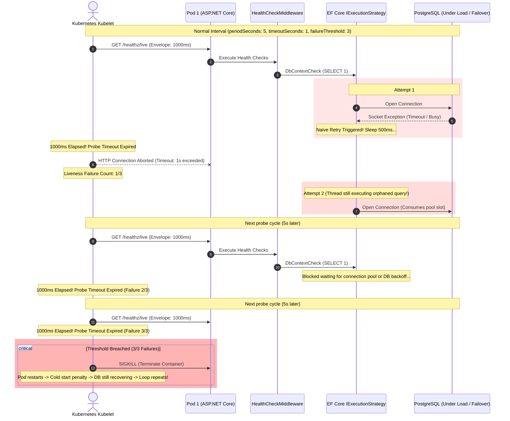
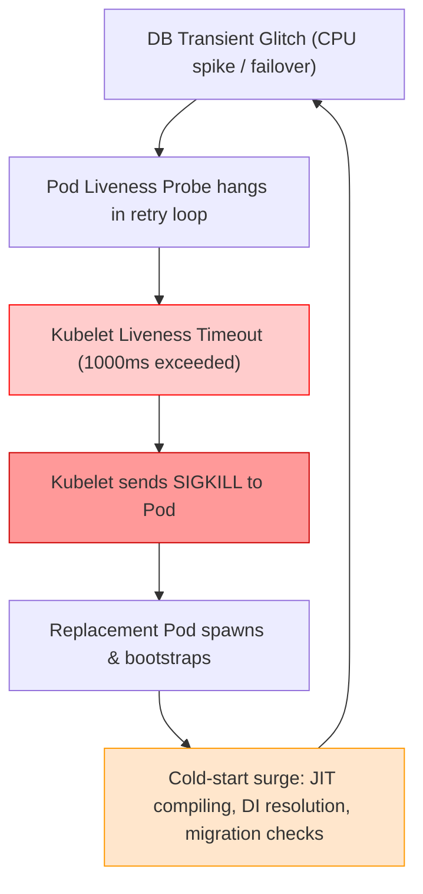

# Health Checks in .NET: Probes, Fail-Fast, and Dependency Isolation

## Executive Summary

Health checks are a diagnostic path, not an operational one. Orchestrators use startup, liveness, and readiness probes to decide whether a process should start, keep running, or receive traffic. Those decisions happen under a hard latency envelope, and retrying inside a probe works against the orchestrator rather than with it.

This guide covers probe taxonomy, orchestrator timeout budgets, the failure modes caused by retrying probes, ASP.NET Core health-check configuration, EF Core/Npgsql isolation patterns, downstream probes, and probe observability. For the general retry principles behind fail-fast behavior, see [Guide A](connection-resilience.md). For the EF Core + Npgsql mechanics referenced by the database patterns, see [Guide B](efcore-connection-resilience.md).

---

## 1. The Diagnostic Path: Why Probes Are Not Operations

Operational requests and diagnostic probes have opposite goals:

- **Operational requests** maximize transaction success. They may retry, use backoff, and consume shared resources.
- **Diagnostic probes** maximize the accuracy of a health report. They must answer quickly, fail fast, and avoid consuming the resources they are meant to observe.

A probe runs inside an orchestrator's hard timeout envelope, typically one to three seconds. If the probe spends that envelope retrying, the orchestrator has already recorded a failure before the retry can succeed. The probe has not become more reliable; it has become slower and less truthful.

For the full operational-versus-diagnostic mental model, see [Guide A, §1](connection-resilience.md#1-architectural-overview--mental-model).

---

## 2. Probe Taxonomy: Startup vs. Liveness vs. Readiness

Modern orchestrators (e.g., Kubernetes, Nomad, AWS ECS) differentiate health concerns across three independent probes. Conflating their purposes or applying retries inside them is the primary cause of orchestrator thrashing.

| Probe Type | Core Purpose | Permitted Checks | Action on Failure |
|---|---|---|---|
| Startup (`/healthz/startup`) | Guard slow-starting containers (JIT warmup, schema checks) | EF Core migrations, initial cache priming | Pause liveness and readiness checks until it passes |
| Liveness (`/healthz/live`) | Detect an unrecoverable process deadlock or corrupted state | Process deadlock, internal runtime health (no external dependencies) | Terminate and restart the container (`SIGKILL`) |
| Readiness (`/healthz/ready`) | Verify the instance can safely accept client traffic | Database or Redis ping, queue reachability | Remove the pod from service endpoints |

#### 1. Startup Probe (`/healthz/startup`)
- **Semantics**: Answers: *"Has the application completed bootstrapping?"*
- **Allowed Operations**: JIT warmup, database schema migration verification, local cache priming.
- **Budget**: Relaxed (`failureThreshold: 30`, `periodSeconds: 2` = 60s window).
- **Retry Guidance**: Bounded retries during initial connection negotiation are permissible here because the container is not yet serving production traffic.

#### 2. Liveness Probe (`/healthz/live`)
- **Semantics**: Answers: *"Is this .NET process corrupted, deadlocked, or in an unrecoverable state?"*
- **Allowed Operations**: In-memory health checks only (thread pool health, memory allocations, event loop responsiveness).
- **STRICT PROHIBITION**: **Never check external dependencies (PostgreSQL, Redis, RabbitMQ, HTTP APIs) in a Liveness Probe.** If the database fails, killing the application container does not fix the database; it creates a thundering herd of restarting containers that compound the database outage.
- **Budget**: Strict sub-second (`timeoutSeconds: 1`, `failureThreshold: 3`).
- **Retry Guidance**: **Zero retries.** Must return in < 50ms.

#### 3. Readiness Probe (`/healthz/ready`)
- **Semantics**: Answers: *"Should the ingress/load balancer route user requests to this specific pod right now?"*
- **Allowed Operations**: Lightweight reachability checks for essential dependencies (e.g., direct non-retrying database ping).
- **Action on Failure**: Kubernetes removes the pod from Endpoint slices. The container continues running and processing in-flight requests, but receives no new ingress traffic.
- **Budget**: Hard limit (`timeoutSeconds: 1` to `2`).
- **Retry Guidance**: **Zero in-process retries.** If the database is down or slow, report `Unhealthy` immediately. The orchestrator's `periodSeconds` (e.g., test every 5s) and `failureThreshold` (e.g., 3 consecutive failures) form the external retry loop without stalling threads.

---

## 3. Orchestrator Timeout Envelopes vs. Application Retry Delays

A critical mismatch occurs when orchestrator timing configurations clash with application resilience policies:

```yaml
# Kubernetes Pod Spec (Anti-Pattern Conflict Example)
livenessProbe:
  httpGet:
    path: /healthz/live
    port: 8080
  initialDelaySeconds: 5
  periodSeconds: 5
  timeoutSeconds: 1        # HARD ENVELOPE: 1000ms
  failureThreshold: 3
readinessProbe:
  httpGet:
    path: /healthz/ready
    port: 8080
  periodSeconds: 5
  timeoutSeconds: 1        # HARD ENVELOPE: 1000ms
  failureThreshold: 3
```

If the health check delegates to an operational retry pipeline:
$$\text{Attempt 1} (200\text{ms}) + \text{Sleep} (500\text{ms}) + \text{Attempt 2} (400\text{ms}) = 1100\text{ms}$$

Because $1100\text{ms} > 1000\text{ms}$ (`timeoutSeconds`), the orchestrator closes the socket and marks the probe as failed. Worse, the application thread remains alive, holding database connections and CPU cycles for an aborted probe.

---

## 4. Failure Modes of Retrying Health Checks

Applying retry policies inside diagnostic health checks transforms minor, recoverable infrastructure blips into catastrophic multi-service outages. The following four operational failure modes represent standard post-mortem findings across distributed .NET systems.

### 4.1 The Probe Timeout Cascade (Sequence)

When a health check runs internal retries, it violates the orchestrator's timeout envelope (`timeoutSeconds: 1`), causing cascading pod terminations:



### 4.2 Failure Mode 1: Probe Timeout Cascades

Orchestrators evaluate probe status via a binary condition: either an HTTP response is received before `timeoutSeconds` expires, or the probe is declared failed.

```
Probe Deadline (1000ms)
|-----------------------------------------------------> [TIMEOUT FAIL]
0ms          250ms        500ms        750ms        1000ms       1250ms
|--Attempt 1--|--Backoff---|--Attempt 2--|--Backoff---|--Attempt 3--|
 (Socket Drop)  (Sleep 250) (Socket Drop)  (Sleep 500) (DB Recovered)
                                                       ^
                                                       Orchestrator already dropped socket at 1000ms!
```

- **Mechanism**: The database experiences a 300ms network hiccup. An internal retry strategy schedules Attempt 2 after a 500ms backoff. Attempt 2 initiates at 750ms and succeeds at 1250ms.
- **Outcome**: Even though Attempt 2 ultimately succeeded, the orchestrator canceled the HTTP socket at 1000ms. The probe is recorded as a failure.
- **Orphaned Work**: The application continues executing the database query and consuming connection resources long after the client socket has been abandoned.

### 4.3 Failure Mode 2: Pod Restart Death Spirals

When developers mistakenly bind database checks or retrying pipelines to **Liveness** probes, transient downstream degradation causes immediate container self-destruction:



1. **Trigger**: PostgreSQL initiates a primary-to-replica failover (typically 5–15 seconds).
2. **Amplification**: Pod liveness checks retry against the unavailable database, exceed the 1s timeout, and breach `failureThreshold: 3`.
3. **Cascade**: Kubernetes kills all application pods simultaneously.
4. **Death Spiral**: As 50+ replacement pods start simultaneously, their startup routines flood the recovering database with hundreds of new connection handshakes and TLS negotiations, preventing PostgreSQL from ever finishing its recovery.

### 4.4 Failure Mode 3: Connection Pool Starvation

In ADO.NET and Npgsql, connection pools are finite resources per process (default `MaxPoolSize = 100`).

With the default `MaxPoolSize = 100`, the pool can become exhausted:

1. **Slots 1–98:** In-flight requests hold connections while waiting on database locks.
2. **Slot 99:** An incoming health check waits in the connection acquisition queue for a free slot.
3. **Timeout mismatch:** Npgsql's default connection timeout is 15 seconds, but the kubelet probe allows only 1 second.

> **Result:** The health check times out because the application pool has no free slots—not necessarily because the database is down.

When high operational concurrency fills the pool, an incoming health check that shares that same pool must wait in line. If the probe waits for a pool slot for more than 1 second, the probe times out. The orchestrator removes the pod from the service endpoint, reducing the replica count and diverting *even more* traffic onto the remaining pods, quickly causing a total cluster domino collapse.

### 4.5 Failure Mode 4: Retry Amplification Storms

Consider a cluster of $N = 40$ microservice instances. Each instance evaluates readiness every $P = 5$ seconds:

$$\text{Baseline Health Traffic} = \frac{40 \text{ pods}}{5 \text{ seconds}} = 8 \text{ probes/second}$$

Now introduce an internal retry policy with 3 attempts and 200ms backoff:
- When PostgreSQL experiences a momentary IO freeze, every probe fails Attempt 1 and fires Attempts 2 and 3.
- Effective query volume surges to $8 \times 3 = 24 \text{ queries/second}$.
- These synthetic probe queries compete directly with operational write transactions for PostgreSQL backend executor worker threads and WAL buffers.
- The health check, intended to monitor system stability, becomes the primary agent of database denial-of-service.

---

## 5. ASP.NET Core Health Check Configuration

### 5.1 Route Tagging Standard

In ASP.NET Core (.NET 10), partition endpoints strictly using tags:

```csharp
// Program.cs
var app = builder.Build();

// Liveness: Process-only checks
app.MapHealthChecks("/healthz/live", new HealthCheckOptions
{
    Predicate = registration => registration.Tags.Contains("live"),
    ResponseWriter = UIResponseWriter.WriteHealthCheckUIResponse
});

// Readiness: Dependency reachability (fail-fast only)
app.MapHealthChecks("/healthz/ready", new HealthCheckOptions
{
    Predicate = registration => registration.Tags.Contains("ready"),
    ResponseWriter = UIResponseWriter.WriteHealthCheckUIResponse
});

// Startup: Initialization checks
app.MapHealthChecks("/healthz/startup", new HealthCheckOptions
{
    Predicate = registration => registration.Tags.Contains("startup"),
    ResponseWriter = UIResponseWriter.WriteHealthCheckUIResponse
});
```

---

## 6. Database Health Check Isolation Patterns

To eliminate probe timeout cascades and pool exhaustion, database diagnostic checks must be completely decoupled from EF Core's retry strategy and primary connection pool.

### 6.1 The EF Core `IExecutionStrategy` Trap

The default ASP.NET Core database check registration:

```csharp
// ANTI-PATTERN: Inherits EnableRetryOnFailure from DbContext
builder.Services.AddHealthChecks()
    .AddDbContextCheck<AppDbContext>("database", tags: ["ready"]);
```

When `AppDbContext` is registered with:

```csharp
options.UseNpgsql(connString, npgsql => npgsql.EnableRetryOnFailure(
    maxRetryCount: 5,
    maxRetryDelay: TimeSpan.FromSeconds(30),
    errorCodesToAdd: null));
```

`AddDbContextCheck<T>` invokes `DbContext.Database.CanConnectAsync()`. Under transient network degradation, `CanConnectAsync()` executes within `NpgsqlRetryingExecutionStrategy`. Instead of returning failure to Kubernetes within milliseconds, the check executes up to 5 retries across 30 seconds. The probe is terminated by the orchestrator after 1000ms, logging an orphaned thread and masking the true state of the service.

---

### 6.2 Pattern 1: Bypassing `IExecutionStrategy` on the Existing Context

If you must use `AppDbContext` for readiness checks, bypass the execution strategy and inject an explicit, short cancellation token.

```csharp
using Microsoft.Extensions.Diagnostics.HealthChecks;
using Microsoft.EntityFrameworkCore;
using System.Data;
using System.Data.Common;

public sealed class NonRetryingDbContextHealthCheck : IHealthCheck
{
    private readonly IServiceProvider _serviceProvider;
    private static readonly TimeSpan ProbeTimeout = TimeSpan.FromMilliseconds(800);

    public NonRetryingDbContextHealthCheck(IServiceProvider serviceProvider)
    {
        _serviceProvider = serviceProvider;
    }

    public async Task<HealthCheckResult> CheckHealthAsync(
        HealthCheckContext context,
        CancellationToken cancellationToken = default)
    {
        // Enforce sub-second probe envelope
        using var probeCts = CancellationTokenSource.CreateLinkedTokenSource(cancellationToken);
        probeCts.CancelAfter(ProbeTimeout);

        try
        {
            // Resolve DbContext within an isolated scope
            using var scope = _serviceProvider.CreateScope();
            var dbContext = scope.ServiceProvider.GetRequiredService<AppDbContext>();

            // Access raw connection to bypass IExecutionStrategy
            var connection = dbContext.Database.GetDbConnection();

            if (connection.State != ConnectionState.Open)
            {
                await connection.OpenAsync(probeCts.Token).ConfigureAwait(false);
            }

            await using var command = connection.CreateCommand();
            command.CommandText = "SELECT 1;";
            command.CommandTimeout = 1; // 1 second command timeout

            var result = await command.ExecuteScalarAsync(probeCts.Token).ConfigureAwait(false);

            return Convert.ToInt32(result) == 1
                ? HealthCheckResult.Healthy("Database connectivity confirmed (non-retrying).")
                : HealthCheckResult.Degraded("Unexpected probe query response.");
        }
        catch (OperationCanceledException) when (!cancellationToken.IsCancellationRequested)
        {
            return HealthCheckResult.Unhealthy("Database probe timed out (>800ms). Fail-fast enforced.");
        }
        catch (Exception ex)
        {
            return HealthCheckResult.Unhealthy($"Database probe failed: {ex.Message}", ex);
        }
    }
}
```

---

### 6.3 Pattern 2: Dedicated Connection Pool & Non-Retrying Npgsql Source (Recommended)

The gold standard for production isolation is a **dedicated, minimal connection pool** exclusively reserved for health checks. This guarantees that operational request spikes cannot starve health probes, and health probes cannot exhaust operational pools.

#### Dedicated Connection String Configuration

```json
{
  "ConnectionStrings": {
    "DefaultConnection": "Host=postgres;Database=appdb;Username=app;Password=secret;Maximum Pool Size=100;Timeout=15",
    "HealthCheckConnection": "Host=postgres;Database=appdb;Username=app;Password=secret;Maximum Pool Size=2;Minimum Pool Size=1;Timeout=2;Command Timeout=1;Application Name=diagnostics_probe"
  }
}
```

#### Production Fail-Fast Health Check Implementation

```csharp
using Npgsql;
using Microsoft.Extensions.Diagnostics.HealthChecks;

public sealed class DedicatedPoolPostgresHealthCheck : IHealthCheck
{
    private readonly NpgsqlDataSource _healthCheckDataSource;
    private static readonly TimeSpan HardProbeLimit = TimeSpan.FromMilliseconds(750);

    public DedicatedPoolPostgresHealthCheck(
        [FromKeyedServices("HealthCheckDataSource")] NpgsqlDataSource healthCheckDataSource)
    {
        _healthCheckDataSource = healthCheckDataSource;
    }

    public async Task<HealthCheckResult> CheckHealthAsync(
        HealthCheckContext context,
        CancellationToken cancellationToken = default)
    {
        using var probeCts = CancellationTokenSource.CreateLinkedTokenSource(cancellationToken);
        probeCts.CancelAfter(HardProbeLimit);

        try
        {
            // Checks out a connection strictly from the dedicated 2-connection pool
            await using var connection = await _healthCheckDataSource.OpenConnectionAsync(probeCts.Token)
                .ConfigureAwait(false);

            await using var command = new NpgsqlCommand("SELECT 1;", connection);
            command.CommandTimeout = 1;

            var scalar = await command.ExecuteScalarAsync(probeCts.Token).ConfigureAwait(false);

            return Convert.ToInt32(scalar) == 1
                ? HealthCheckResult.Healthy("Database probe succeeded via dedicated pool.")
                : HealthCheckResult.Degraded("Database returned unexpected scalar.");
        }
        catch (OperationCanceledException) when (!cancellationToken.IsCancellationRequested)
        {
            // Probe timeout reached: Report Unhealthy immediately without retry
            return HealthCheckResult.Unhealthy("Readiness probe timed out waiting for DB connection (>750ms).");
        }
        catch (Exception ex)
        {
            // Fast failure without retry loops
            return HealthCheckResult.Unhealthy($"Readiness probe failed fast: {ex.Message}", ex);
        }
    }
}
```

#### Service Registration in `Program.cs`

```csharp
// 1. Primary operational DbContext with retrying strategy and large connection pool
builder.Services.AddDbContext<AppDbContext>(options =>
{
    options.UseNpgsql(builder.Configuration.GetConnectionString("DefaultConnection"), npgsql =>
    {
        npgsql.EnableRetryOnFailure(maxRetryCount: 3, maxRetryDelay: TimeSpan.FromSeconds(5), errorCodesToAdd: null);
    });
});

// 2. Dedicated NpgsqlDataSource for diagnostics with minimal connection pool (MaxPoolSize=2)
var healthCheckConnString = builder.Configuration.GetConnectionString("HealthCheckConnection");
var healthDataSource = new NpgsqlDataSourceBuilder(healthCheckConnString).Build();
builder.Services.AddKeyedSingleton("HealthCheckDataSource", healthDataSource);

// 3. Register isolated readiness check
builder.Services.AddHealthChecks()
    .AddCheck<DedicatedPoolPostgresHealthCheck>(
        name: "postgres_dedicated_probe",
        failureStatus: HealthStatus.Unhealthy,
        tags: ["ready"]);
```

---

## 7. Downstream HTTP Probes and the Diagnostic Pipeline

### 7.1 Diagnostic Pipeline Registration

```csharp
using Microsoft.Extensions.DependencyInjection;
using Polly;
using Polly.Timeout;

public static class DiagnosticResilienceConfigurationExtensions
{
    public static IServiceCollection AddDiagnosticResiliencePipeline(this IServiceCollection services)
    {
        // =========================================================================
        // Diagnostic Pipeline: Used exclusively for health check probes
        // =========================================================================
        services.AddResiliencePipeline("diagnostic-pipeline", builder =>
        {
            // Enforce strict fail-fast timeout (800ms budget within 1000ms K8s envelope)
            builder.AddTimeout(new TimeoutStrategyOptions
            {
                Timeout = TimeSpan.FromMilliseconds(800),
                Name = "DiagnosticProbeFailFastTimeout"
            });

            // STRICT REQUIREMENT: No retry strategies added here!
            // When a diagnostic probe encounters an exception, it must fail fast.
        });

        return services;
    }
}
```

### 7.2 Executing Health Checks via the Diagnostic Pipeline

When checking external HTTP microservices or REST APIs in a readiness probe:

```csharp
using Microsoft.Extensions.Diagnostics.HealthChecks;
using Polly;
using Polly.Registry;

public sealed class DownstreamServiceHealthCheck : IHealthCheck
{
    private readonly HttpClient _httpClient;
    private readonly ResiliencePipeline _diagnosticPipeline;

    public DownstreamServiceHealthCheck(
        HttpClient httpClient,
        ResiliencePipelineProvider<string> pipelineProvider)
    {
        _httpClient = httpClient;
        // Inject the non-retrying fail-fast pipeline
        _diagnosticPipeline = pipelineProvider.GetPipeline("diagnostic-pipeline");
    }

    public async Task<HealthCheckResult> CheckHealthAsync(
        HealthCheckContext context,
        CancellationToken cancellationToken = default)
    {
        try
        {
            // Execute the probe wrapped in the 800ms fail-fast envelope with ZERO retries
            var response = await _diagnosticPipeline.ExecuteAsync(async token =>
            {
                using var request = new HttpRequestMessage(HttpMethod.Get, "/healthz/live");
                return await _httpClient.SendAsync(request, HttpCompletionOption.ResponseHeadersRead, token)
                                        .ConfigureAwait(false);
            }, cancellationToken).ConfigureAwait(false);

            return response.IsSuccessStatusCode
                ? HealthCheckResult.Healthy("Downstream dependency responsive.")
                : HealthCheckResult.Degraded($"Downstream returned status code {(int)response.StatusCode}.");
        }
        catch (TimeoutRejectedException)
        {
            // Captured from Polly's 800ms timeout
            return HealthCheckResult.Unhealthy("Downstream health probe timed out (>800ms). Fail-fast asserted.");
        }
        catch (Exception ex)
        {
            return HealthCheckResult.Unhealthy($"Downstream health probe failed: {ex.Message}", ex);
        }
    }
}
```

---

## 8. Observability: Probe Metrics, Tagging, and Logging

Transparent observability ensures engineers can see probe latency and failure status without mixing probe traffic into the main distributed traces.

### 8.1 Probe Metrics

```csharp
// Program.cs
builder.Services.AddOpenTelemetry()
    .WithMetrics(metrics =>
    {
        metrics
            .AddMeter("Microsoft.AspNetCore.Diagnostics.HealthChecks")
            .AddPrometheusExporter();
    })
    .WithTracing(tracing =>
    {
        tracing
            .AddAspNetCoreInstrumentation(options =>
            {
                // Exclude noisy health checks from main distributed traces
                options.Filter = httpContext => !httpContext.Request.Path.StartsWithSegments("/healthz");
            });
    });
```

#### Key Metrics to Alert On

| Metric Name | Instrument | Description | Healthy Threshold |
| :--- | :--- | :--- | :--- |
| `health_check.execution.duration` | Histogram | Execution time of individual health probes | $< 200\text{ms}$ (p99) |

Retry and circuit metrics are covered in [Guide A](connection-resilience.md#6-observability-principles). Database pool and EF Core metrics are covered in [Guide B](efcore-connection-resilience.md).

### 8.2 Probe Logging

When a probe fails, structured logging must provide actionable contextual dimensions without flooding log collectors.

```json
{
  "Timestamp": "2026-11-06T23:14:02.850Z",
  "LogLevel": "Error",
  "Message": "Readiness probe failed fast: connection timeout.",
  "CheckName": "postgres_dedicated_probe",
  "ProbeType": "readiness",
  "DurationMs": 751,
  "IsFailFast": true,
  "ActionTaken": "UnhealthyReturnedToOrchestrator"
}
```

---

## 9. Summary Checklist

| Category | Recommended Practice | Dangerous Anti-Pattern |
| :--- | :--- | :--- |
| **Probe Strategy** | Enforce **fail-fast (zero retries)** on all health checks. Let the orchestrator govern retry intervals. | Putting Polly retries or EF Core retrying execution strategies inside health checks. |
| **Liveness Checks** | Restrict `/healthz/live` to in-memory, process-local diagnostics only (thread pools, deadlocks). | Checking PostgreSQL, Redis, or HTTP downstream services in liveness probes. |
| **Readiness Checks** | Use strict sub-second timeouts ($<800\text{ms}$) on `/healthz/ready`. Return `Unhealthy` on failure. | Long probe timeouts ($>3\text{s}$) causing orchestrator timeout cascades. |
| **Database Connections**| Use a dedicated connection string and pool (`MaxPoolSize=2`) for health probes. | Sharing the primary EF Core connection pool for health checks, inducing pool starvation. |

---

## 10. Related Guides

- [**Guide A — Connection Resilience in .NET**](connection-resilience.md): retry principles, backoff and jitter, retry budgets, timeout and cancellation envelopes, and idempotency.
- [**Guide B — Entity Framework Core Connection Resilience on PostgreSQL**](efcore-connection-resilience.md): execution strategy mechanics, SQLSTATE taxonomy, retriable units, and idempotency patterns.
- [**Suite index**](README.md): choose the right guide for the task.
